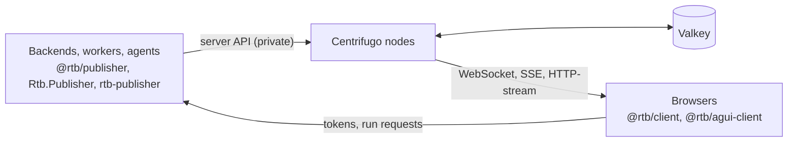

# realtime-backbone

A realtime service for every workload: AI agent chat, background jobs, UI updates and system broadcasts. It is [Centrifugo](https://centrifugal.dev) (Apache 2.0, unmodified) on a Valkey backplane, packaged with a channel and event contract, thin SDKs for TypeScript, .NET and Python, and deployment for Compose, Railway and Kubernetes.

Backends publish over Centrifugo's server API. Browsers subscribe with short-lived tokens that the app's backend mints. Centrifugo never calls back into an app.



- Design: [docs/DESIGN.md](docs/DESIGN.md). Plan and status: [docs/IMPLEMENTATION.md](docs/IMPLEMENTATION.md).
- Channel names: [spec/channels.md](spec/channels.md). Envelope and events: [spec/events.md](spec/events.md).

## Quickstart (dev stack, 5 minutes)

Needs Docker, Node 22+ and pnpm. No `.env` is needed.

```sh
pnpm install
pnpm dev:up          # Valkey, the backbone and a demo; test page at http://localhost:8080
pnpm dev:doctor      # checks the config and the backplane
pnpm samples:up      # the agent samples; prints their URLs
```

The test page shows job ticks, an agent run that survives a reload, presence and per-user notices. Try `?transport=sse` to see the fallback transport.

| Script | Does |
| --- | --- |
| `pnpm dev:up` / `dev:down` / `dev:purge` | Start the dev stack / stop everything (samples too) / stop and delete the data in `.data/` |
| `pnpm dev:logs` / `dev:doctor` | Follow the logs / run `rtb-doctor` against the dev stack |
| `pnpm samples:up` / `samples:logs` | Build and start the samples, then print their URLs / follow their logs |
| `pnpm samples:signals` | Run the Python backtest worker once (`SPEED`, `CANDLES`, `SYMBOL` change it) |
| `pnpm build` / `test` | Build the TypeScript packages / run their unit tests and conformance vectors |
| `pnpm test:integration` | TypeScript against the backbone and Valkey in containers |
| `pnpm e2e` | Browser tests against the running dev stack and every sample (or `pnpm e2e tests/demo.spec.ts`) |

The samples:

| Sample | URL |
| --- | --- |
| Mastra chat | http://localhost:3001 |
| Microsoft Agent Framework chat | http://localhost:3002 |
| Pydantic AI chat | http://localhost:3003 |
| LangGraph chat | http://localhost:3004 |
| Mastra agent + .NET API + plain AG-UI page, with frontend tools and approvals | http://localhost:3010 |

## Environment

Everything has a dev default, so nothing needs setting. To change something, export the variable or put it in a `.env` at the repo root (Docker Compose reads it, and it is gitignored).

| Variable | Default | What |
| --- | --- | --- |
| `RTB_CLIENT_PORT` | 8000 | The backbone's client port on your machine |
| `RTB_DEMO_PORT` | 8080 | The test page |
| `RTB_SAMPLE_PORT`, `RTB_MAF_SAMPLE_PORT`, `RTB_PY_SAMPLE_PORT`, `RTB_LANGGRAPH_SAMPLE_PORT` | 3001, 3002, 3003, 3004 | The chat samples |
| `RTB_MDN_API_PORT`, `RTB_MDN_AGENT_PORT` | 3010, 3011 | The Mastra + .NET sample |
| `MODEL`, `OPENAI_API_KEY` | unset | Use a real model in the Mastra samples and `py-chat` instead of the scripted one, for example `MODEL=openai/gpt-5-mini` |

The dev stack's secrets (API keys, the token signing key in `.data/keys/`) are fixed dev values set in `compose.yaml`. The single-host deployment in `deploy/compose` is different: it needs a `.env`, made from `deploy/compose/.env.example`.

## What's in the repo

| Path | What |
| --- | --- |
| `spec/` | Channel grammar, envelope schema and the conformance vectors both SDKs run |
| `config/centrifugo.json` | The backbone's Centrifugo config; secrets come from `CENTRIFUGO_*` env vars |
| `images/backbone` | The backbone image: pinned Centrifugo plus the config and `rtb-doctor` |
| `tools/doctor` | `rtb-doctor` (Go): checks the config and the Valkey backplane |
| `ts/` | `@rtb/contract`, `@rtb/publisher`, `@rtb/tokens`, `@rtb/client`, `@rtb/agui-client`, `@rtb/agui-server` |
| `dotnet/` | `Rtb.Contract`, `Rtb.Publisher` (gRPC), `Rtb.Tokens`, `Rtb.AgUi`, `Rtb.AgUi.AgentFramework` |
| `python/` | `rtb-contract`, `rtb-publisher` (HTTP and gRPC), `rtb-tokens`, `rtb-agui`; see [python/README.md](python/README.md) |
| `samples/` | `mastra-chat`, `maf-chat`, `py-chat` (Pydantic AI and LangGraph), the chat page they share, `mastra-dotnet` (Mastra + .NET API + AG-UI page), and the `py-signals` backtest worker |
| `deploy/compose` | Single-host deployment from published images |
| `deploy/railway` | Railway template |
| `deploy/helm` | Helm chart wrapping the upstream Centrifugo chart |
| `docs/` | Design, plan, [backplane guide](docs/deploy/backplane.md), [runbooks](docs/runbooks/), [publishing with curl](docs/publish-with-curl.md), [SDK spec](docs/sdk-spec.md), [SOC 2 controls](docs/soc2-controls.md) |

Package names (`@rtb/*`, `Rtb.*`, `rtb-*`) are placeholders until the project's name is settled. Nothing is published to npm, NuGet or PyPI yet.

## Tests

| Command | What |
| --- | --- |
| `pnpm build && pnpm test` | TypeScript unit tests and conformance vectors |
| `pnpm --filter @rtb/integration test:integration` | TypeScript against the backbone and Valkey in containers |
| `cd dotnet && dotnet test` | .NET unit tests, conformance vectors and integration tests |
| `cd python && uv run pytest` (add `-m integration` for containers) | Python unit tests, conformance vectors and integration tests |
| `pnpm --filter @rtb/e2e test` | Browser tests against the running dev stack and samples |

## License

MIT, see [LICENSE](LICENSE). Centrifugo is Apache 2.0; see [NOTICE](NOTICE).
