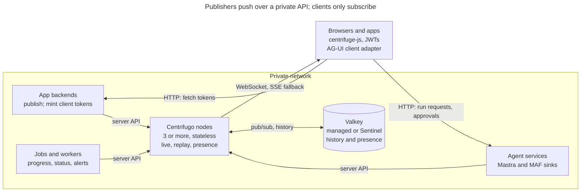

# Realtime Backbone Design

Oct 10, 2026 · @Matt C.

**v0 deployment assumption: publishers share a private network with the backbone.** This is a security recommendation, not a technical limit. Centrifugo's server API works the same over a public endpoint; keeping it private is one of v0's controls for the single shared key (see Authentication). On Railway, private networking covers one project and environment, so publishers in other projects need a public endpoint.

If you expose the publish API publicly:

- **HTTP API:** works through any standard HTTPS endpoint, including Railway's generated domains. The API key then travels over the internet, so TLS is mandatory.
- **gRPC API:** needs end-to-end HTTP/2. Railway's generated HTTPS domains reportedly forward HTTP/1.1 to the container (stated in a Railway community template, not Railway's own docs; verify before relying on it). Use Railway's TCP proxy instead and have Centrifugo terminate TLS itself with client certificates (mTLS), since the TCP proxy adds no TLS.
- **Shared key:** anyone holding it can publish to any tenant. Scoped publisher keys (v1) are the recommended prerequisite before many projects publish over a public endpoint.

## Summary and decisions

The backbone is Centrifugo OSS (Apache 2.0) on a Valkey/Redis backplane. We ship it as an MIT-licensed distribution: deployment manifests, a channel and event contract, and thin publisher and token SDKs for .NET, TypeScript and Python. It knows nothing about the apps that use it. Publishers push over its server API, clients subscribe with tokens, and Centrifugo never calls back into an app.

| Decision | Choice | Why |
| --- | --- | --- |
| Engine | Centrifugo v6 OSS | Proven, horizontally scalable, history and recovery, WebSocket plus SSE and HTTP-streaming fallbacks |
| Backplane | Valkey/Redis (Sentinel, then Cluster) | Full feature set across nodes; NATS is at-most-once only; the PostgreSQL broker is experimental |
| Default delivery | Ephemeral (`live`) | Nobody listening means the message is dropped |
| Replay | Opt-in per namespace (`replay`) | Short history so reconnecting clients catch up |
| Publisher auth, v0 | One server API key on a private network, mTLS per component on gRPC | Simple; scoped keys come in v1 |
| Client auth | Short-lived connection and subscription JWTs minted by each app's backend | Tenant is enforced in the token; no callbacks from Centrifugo |
| Agent chat | AG-UI events on per-run `replay` channels | Same path for Mastra and MAF |
| Out of scope | CDC, outbox, durable queues, offline notifications | Keeps the backbone decoupled |

## Goals and non-goals

The backbone moves live status from any producer to whoever is listening right now, and nothing more.

**Goals**

- One realtime service for every workload: AI agents, background jobs, UI components, system broadcasts.
- Four audiences: global, tenant, channel or group, and single user.
- Ephemeral by default, with short replay where a reconnecting client must catch up.
- Scale out by adding Centrifugo nodes; the backplane scales separately.
- Installable and configurable from one repo: Compose for dev and single-host deployments, a Railway template, Helm for production, all from published images.
- Primary transport for agent chat output from both Mastra (TypeScript) and MAF (.NET).

**Non-goals**

- No CDC, outbox or database integration. Producers decide what to publish and call the API.
- No callbacks from Centrifugo into apps: no connect, subscribe, publish or RPC proxies.
- Not a durable queue or event store. Work that must not be lost belongs in the app's own store.
- Not an offline notification system. Push and email for users who are away stay in the app.
- No forked Centrifugo. We configure and wrap it, never patch it.

## Architecture and topology

Traffic only flows one way through Centrifugo: backends publish into it, clients receive from it, and everything a client sends goes to an app over plain HTTP.



Publishers reach the server API inside the private network (gRPC with mTLS, plus the API key). Centrifugo nodes share pub/sub, history and presence through Valkey, so a client on any node gets every publication. Browsers fetch tokens from an app backend and send run requests and approvals to the agent service, never to Centrifugo.

## Delivery tiers and namespaces

Each tier is a Centrifugo namespace, so a publisher picks its delivery guarantee by the channel prefix it writes to. History needs both `history_size` and `history_ttl`; `force_recovery` makes every subscription in the namespace recoverable.

| Tier | Namespace | Delivery | Typical use |
| --- | --- | --- | --- |
| Ephemeral | `live` | At most once; dropped if nobody is subscribed | Job progress ticks, UI invalidation hints, system broadcasts, per-user alerts |
| Short replay | `replay` | At least once within the history window; missed messages recovered on reconnect | Agent chat runs, long job logs, anything a page reload must not lose mid-stream |
| Presence | `presence` | Who is subscribed, plus join and leave events | Who is online, who is viewing a record |

Starting config (history values are first guesses to tune under load; keys checked against Centrifugo v6.9.7):

```json
{
  "channel": {
    "publication_data_format": "json_object",
    "namespaces": [
      { "name": "live", "allow_user_limited_channels": true,
        "channel_regex": "^(global\\.[A-Za-z0-9_-]+(\\.[A-Za-z0-9_-]+)?|t-[A-Za-z0-9_-]{1,64}\\.([A-Za-z0-9_-]+(\\.[A-Za-z0-9_-]+)?|user#[A-Za-z0-9_-]{1,128}))$" },
      { "name": "replay", "allow_user_limited_channels": true,
        "history_size": 2000, "history_ttl": "600s", "history_meta_ttl": "1800s",
        "force_recovery": true,
        "channel_regex": "^(global\\.[A-Za-z0-9_-]+(\\.[A-Za-z0-9_-]+)?|t-[A-Za-z0-9_-]{1,64}\\.([A-Za-z0-9_-]+(\\.[A-Za-z0-9_-]+)?|user#[A-Za-z0-9_-]{1,128}))$" },
      { "name": "presence", "presence": true, "join_leave": true,
        "force_push_join_leave": true, "allow_presence_for_subscriber": true,
        "channel_regex": "^t-[A-Za-z0-9_-]{1,64}\\.[A-Za-z0-9_-]+(\\.[A-Za-z0-9_-]+)?$" }
    ]
  },
  "sse": { "enabled": true },
  "http_stream": { "enabled": true }
}
```

- `publication_data_format: json_object` (Centrifugo v6.5.2 and later) rejects any publication that is not a JSON object, on both the server API and client publishes, with error `107: bad request`. It does not check the envelope fields; the SDKs do.
- `channel_regex` rejects malformed channel names at the edge. It matches the part after `<tier>:`, uses Go regexp (no lookahead), and only applies to client subscriptions, so it checks the shape and the SDKs check reserved words. The full grammar is in `spec/channels.md`.
- `sse` and `http_stream` turn on the fallback transports. centrifuge-js only uses them if they are listed in its `transports` option.
- `allow_presence_for_subscriber` lets a subscriber load the current roster; without it, clients only see join and leave events after they arrive.
- `history_meta_ttl` bounds how long a finished run's stream position lingers in Valkey. Every run gets its own channel, so without it each run leaves a key behind for the default of 30 days (`720h`). It must be larger than `history_ttl`.
- Presence calls return every subscriber, so presence channels stay per record or room. Tenant-wide "who is online" uses `presence_stats` (counts) or the app's own store.
- No namespace sets `allow_subscribe_for_client`. Every subscription needs a token, except user-limited `#` channels, which check the user ID in the connection token.
- Replay history lives in Valkey, so it survives a Centrifugo restart; durability then depends on Valkey's persistence settings.
- A durable tier is not planned. If a message must survive beyond `history_ttl`, the app stores it and the UI fetches it over the app's API.

## Channel naming and tenancy

Every channel is `<tier>:<scope>.<topic>[.<id>]`, and the scope segment carries the tenant, so isolation is readable from the name alone. Centrifugo treats `:` as the namespace boundary and `#` as the user boundary; dots are ordinary characters we use for structure.

| Audience | Pattern | Example |
| --- | --- | --- |
| Global | `live:global.<topic>` | `live:global.maintenance` |
| Tenant-wide | `live:t-<tenant>.all` | `live:t-acme.all` |
| Topic or record | `live:t-<tenant>.<topic>.<id>` | `live:t-acme.jobs.01JB7Q` |
| Group | `live:t-<tenant>.grp.<group>` | `live:t-acme.grp.ops` |
| Single user | `live:t-<tenant>.user#<userId>` | `live:t-acme.user#u_8f3a` |
| Single user, survives a reload | `replay:t-<tenant>.user#<userId>` | `replay:t-acme.user#u_8f3a` |
| Agent run | `replay:t-<tenant>.run.<runId>` | `replay:t-acme.run.01JB7R` |
| Presence | `presence:t-<tenant>.<topic>.<id>` | `presence:t-acme.doc.881` |

**Rules**

- ASCII only, 255 characters at most. IDs are opaque (ULID or UUID), never names or emails. A key with other characters (a ticker like `BRK.B`, a path) goes through the SDKs' `encodeId`, the same in every language.
- Tenant IDs, topics and IDs are `[A-Za-z0-9_-]+`, with tenants at most 64 characters, matched case-sensitively. A channel has exactly `topic` or `topic.id` after the scope; deeper nesting is rejected in v0.
- `all`, `grp`, `user` and `run` are reserved topic words with the meanings above.
- `#` channels exist in `live` and `replay`, never in `presence`. Presence has no `global` or tenant-wide (`all`) channels either.
- The full grammar, builders and test vectors are in `spec/channels.md` and `spec/vectors/`.
- The tenant segment is always second. `global` is reserved and never a tenant ID.
- User IDs in the `sub` claim are globally unique, so a `#` channel can never match a user in another tenant.
- Channel names never carry secrets or personal data; they show up in logs and metrics.

**Where tenancy is enforced in v0**

1. Token minting signs a subscription token only for channels whose tenant segment matches the caller's tenant, and only for groups the caller belongs to.
2. The publisher SDK refuses to publish to a channel whose tenant segment differs from the tenant context it was given, and logs the attempt. Publishing to `global` needs an explicit `allowGlobal` flag on the publisher, off by default.
3. Centrifugo verifies tokens; it does not know what a tenant is. Scoped publisher keys in v1 add a third check at the edge.

## Authentication, authorization and SOC 2 controls

Publishers and subscribers authenticate differently: trusted backends use the server API key, and browsers use short-lived JWTs that only an app backend can mint.

**Publishers (backends, agents, workers)**

- HTTP server API with the `X-API-Key` header, or gRPC with `authorization: apikey <key>` metadata.
- Centrifugo v6 takes one key per API (`http_api.key`, `grpc_api.key`). Rotating it needs a short coordinated window; scoped keys in v1 remove that.
- gRPC runs with mTLS and a client certificate per component, so each connection is attributable and one component can be cut off alone.
- The API listens only on the private network. Setting `http_server.internal_port` moves the HTTP API, health and metrics endpoints off the client port (checked: `POST /api/publish` on the client port returns 404). The client endpoint is the only thing exposed publicly.

**Subscribers (browsers, mobile, desktop)**

- The app backend mints a connection JWT: `sub` = global user ID, `exp` of about 10 minutes, `aud` and `iss` set and checked by Centrifugo. The client SDK refreshes it through `getToken`.
- For each non-user channel, the backend mints a subscription JWT with `sub` and `channel` claims after its own tenant and group checks.
- Tokens are signed with an app-held ES256 key, and the token SDK publishes the public half at a JWKS endpoint. Centrifugo always verifies through a JWKS URL (`client.token.jwks_public_endpoint`), so it holds only public keys. Every token carries a `kid` header.
- Subscription tokens always use the separate block, `client.subscription_token` with `enabled: true` and its own `jwks_public_endpoint`, `audience` and `issuer`. With app-held keys both URLs point at the same JWKS. An adopter whose IdP mints connection tokens points only the connection URL at the IdP.
- Centrifugo v6 JWKS supports `RSA`, `EC` (ES256/384/512) and `OKP` (Ed25519) keys. It caches each key by URL and `kid` for one hour and fetches on an unknown `kid`, with a 1-second timeout and one retry. Rotation is: add the new key to the JWKS, switch signing (Centrifugo fetches the new `kid` the first time it sees it), and drop the old key after the longest token TTL. A removed key can stay in Centrifugo's cache for up to an hour, so after a key leak also restart the nodes.
- Clients cannot publish. Every message comes from a backend through the server API.

**SOC 2 controls for v0 (shared publisher key)**

| Concern | Control in v0 | Improvement in v1 |
| --- | --- | --- |
| Attribution | Publisher SDK audit log (component, tenant, channel, event type, time); mTLS proves a valid certificate but Centrifugo does not log which one | Per-component API keys |
| Least privilege | Publisher SDK tenant guard; API reachable only from the private network | Keys scoped to tenants and channel prefixes |
| Revocation | Short-lived client certificates; stop renewing a component's certificate | Revoke one key |
| Secret handling | Key in a vault; documented rotation and incident runbook | Same, per key |
| Tenant isolation | Token minting checks; tenant guard; tenant ID in every channel name | Scope check at the edge before Centrifugo |
| Transport | TLS on the client endpoint; mTLS on gRPC | Same |

Centrifugo v6 requires and verifies a client certificate when `grpc_api.tls.client_ca_pem` is set, but it does not log the certificate's identity and does not check CRLs or OCSP (checked in the v6.9.7 source). So:

- Revocation means short-lived client certificates (hours, not months, for example 24 hours from cert-manager or step-ca). Cutting off a component means not renewing its certificate.
- Attribution is the SDK audit log. The certificate proves the caller holds a valid certificate, not which component sent which message.
- HTTP publishers, including the TypeScript SDK, can get the same certificate check with `http_server.internal_tls.client_ca_pem`, but that also covers the health and metrics endpoints on the internal port, so it is off by default. Their attribution is the audit log alone.

Auditors decide what is sufficient; this table is the case we make, not a guarantee.

## Agent chat over the backbone

Yes: the backbone can be the primary output channel for agent chat, for Mastra and MAF alike. User input stays a plain HTTP call to the agent service, and only the agent's output travels through Centrifugo. Both frameworks already emit AG-UI events (Mastra through `@ag-ui/mastra`, MAF through the AG-UI .NET SDK), and AG-UI does not mandate a transport, so we carry those same events over a `replay` channel instead of SSE.

**Run flow**

1. The UI posts the AG-UI `RunAgentInput` (thread ID, new messages) to the agent service: a Mastra route or a MAF ASP.NET Core endpoint.
2. The agent service checks the caller, creates a `runId`, records who may watch the run (the owner and any supervisors) so later token requests can be authorized, publishes `RUN_STARTED` to `replay:t-<tenant>.run.<runId>`, and returns `202` with the run and thread IDs, the channel, a subscription token and the stream position (`offset`, `epoch`) of that first event.
3. The UI subscribes with `since: { offset: offset - 1, epoch }`, so `RUN_STARTED` is the first publication it receives and nothing published before the subscription is missed. Checked against Centrifugo v6.9.7: `since` returns publications strictly after `offset`, including when `offset - 1` is `0`. If the epoch no longer matches, the subscription succeeds with `recovered: false` and no history, and the UI loads state from the app's API.
4. A Centrifugo sink in the agent service reads the framework's AG-UI event stream and publishes each event in the envelope. The service passes its `runId` to the framework (both Mastra and MAF honor it) and drops the framework's own `RUN_STARTED`, which would otherwise duplicate step 2. Mastra's `TEXT_MESSAGE_CHUNK` events are normalized to `TEXT_MESSAGE_START`, `CONTENT` and `END`, so every UI sees the same events. Text deltas are batched every 50 to 100 ms rather than sent one token per message. An event over the envelope cap (`MESSAGES_SNAPSHOT` and `STATE_SNAPSHOT` can be) is replaced with an `agui.CUSTOM` `rtb.oversize` marker, and the UI refetches state from the app's API.
5. `RUN_FINISHED` or `RUN_ERROR` ends the run. The agent service stores the final messages in its own thread store; the UI loads past threads from the app's API, never from the backbone.

**What this buys over direct SSE**

- A page reload or network drop mid-run resumes from the history window instead of restarting inference.
- Several tabs, devices or a supervising user can watch the same run.
- Background agents can start runs with nobody watching and tell the user on `live:t-<tenant>.user#<userId>`, pointing at the run channel.
- One transport and one client adapter for every agent, whatever framework built it.

**Rules**

- Tool approvals, cancellation and other human-in-the-loop replies go back to the agent service over HTTP, never as client publishes.
- The agent service is a publisher like any other: server API key, tenant guard, audit log.
- The agent service is a long-running process. It keeps driving the agent after the `202` is sent, which request-scoped serverless functions cannot do.
- One channel per run is enough. The thread's history comes from the app's API, and a UI learns that a new run started on an open thread from a `notice.run_started` on the user channel.
- For a simple single-user chat with no reconnect or observer needs, direct SSE from the agent is simpler. The backbone earns its place once runs outlive a page or have more than one viewer.

**Pieces to build**

- TypeScript: a sink that takes the `MastraAgent` AG-UI event observable and publishes to Centrifugo.
- .NET: a sink that takes MAF's AG-UI event stream and publishes over gRPC.
- Python: a sink that takes Pydantic AI's AG-UI event stream (`AGUIAdapter.run_stream()`), LangGraph's (`ag-ui-langgraph`), or any AG-UI event iterator.
- Browser: an AG-UI client adapter whose transport is a centrifuge-js subscription instead of an SSE request.

## Event envelope and SDKs

Every publication is one JSON envelope, so any client can route, dedupe and audit a message without knowing who sent it.

```json
{
  "v": 1,
  "id": "01JB7S4K2M9Q",
  "type": "agui.TEXT_MESSAGE_CONTENT",
  "tenant": "acme",
  "source": "quality-agent",
  "ts": "2026-10-10T14:03:22.418Z",
  "corr": "01JB7R",
  "data": { }
}
```

| Field | Meaning |
| --- | --- |
| `v` | Envelope version |
| `id` | ULID; also sent as the publish `idempotency_key`, and used by clients to drop duplicates after recovery |
| `type` | Dotted family and name: `agui.*` (AG-UI event type, unchanged), `job.*`, `entity.changed`, `notice.*`, `system.*` |
| `tenant` | Must match the channel's tenant segment (`global` for global channels) |
| `source` | Publishing component ID, matching its mTLS identity |
| `ts` | Publish time, UTC |
| `corr` | Optional correlation ID: run, job or request |
| `data` | The payload. For `agui.*`, the AG-UI event as the framework produced it |

Payloads stay small: IDs and hints, not records. `entity.changed` tells the UI what to refetch from the app's API. We cap envelopes at 64 KB by convention.

The `agui`, `job`, `entity`, `notice` and `system` families are reserved and defined by us; apps may add their own families. Publishers send one message at a time per channel, so retries and batching never reorder deltas.

**Packages** (names are placeholders until open question 1 is settled)

| Package | Runtime | Does |
| --- | --- | --- |
| `Rtb.Contract`, `@rtb/contract` | Any | Channel grammar, envelope types and validation, tenant guard. Both run the same conformance vectors |
| `Rtb.Publisher` | ASP.NET Core, workers, MAF | Publish over gRPC with mTLS; per-channel ordering; retries with backoff; audit log; delta batching |
| `Rtb.Tokens` | ASP.NET Core | Connection and subscription JWTs after the app's own tenant and group checks; JWKS endpoint; token endpoint helpers |
| `Rtb.AgentFramework` | MAF | AG-UI sink and run endpoint helper |
| `@rtb/publisher` | Node | Publish over HTTP; same guard, ordering, retries, audit log and batching |
| `@rtb/tokens` | Node | Same as `Rtb.Tokens`, for Hono, Next.js and Express |
| `@rtb/mastra` | Mastra | AG-UI sink and run endpoint helper |
| `@rtb/client` | Browser | Wraps centrifuge-js: token refresh, SSE fallback, envelope parsing, dedupe, presence helpers |
| `@rtb/agui-client` | Browser | AG-UI `AbstractAgent` whose transport is a `@rtb/client` subscription; reattaches after a reload |
| `rtb-contract` | Python | Same as `@rtb/contract`; runs the same conformance vectors |
| `rtb-publisher` | Python workers and services (asyncio) | Publish over HTTP or gRPC; same guard, ordering, retries, audit log and batching |
| `rtb-tokens` | Starlette, FastAPI | Same as `@rtb/tokens` |
| `rtb-agui` | Pydantic AI, LangGraph, any AG-UI source | AG-UI sink and run endpoint helper |

Any language can publish with one HTTP POST and the envelope; `docs/sdk-spec.md` says what a full SDK must do. In production, every publisher should use an SDK, because the tenant guard and audit log that v0's SOC 2 case relies on live there.

## Deployment and operations

Centrifugo nodes are stateless and scale by count; Valkey holds history and presence and scales separately.

| Profile | Centrifugo | Valkey | For |
| --- | --- | --- | --- |
| Dev (Compose) | 1 node | 1 instance | Local work, demo publisher and test page |
| Single host (Compose) | 1 node | Bundled, or a managed Valkey by address | Small installs and staging, from published images |
| Railway (template) | 1 node | 1 service with a volume | One-click deploy, publishers in the same project |
| Production (Helm) | 3 or more replicas behind a load balancer | A managed Valkey, or the adopter's own primary, replicas and 3 Sentinels | Most production deployments |
| Large (Helm) | Add replicas for connections | Redis Cluster or Centrifugo's app-level sharding | When Valkey CPU becomes the limit |

**Operating rules**

- Only the client endpoint is on the public ingress, with WebSocket support and SSE fallback. The HTTP API and gRPC stay on an internal service behind network policies.
- All config comes from the JSON file plus `CENTRIFUGO_*` environment variables; secrets come from the vault, never the chart's values.
- Turn on Valkey AOF with fsync if replay history must survive a Valkey restart; without it, stream positions can be lost and clients fall back to a fresh state.
- Publish Prometheus metrics and import the official Grafana dashboard. Alert on pub/sub lag (`centrifugo_node_pub_sub_lag_seconds`), Valkey memory and CPU, connection counts per node, and API error rates.
- Connection tokens expire in about 10 minutes and the client SDK refreshes them; size the token endpoint for reconnect storms after a deploy.
- Upgrades roll one node at a time; clients reconnect to another node and `replay` subscriptions recover missed messages.

## Roadmap

v0 ships agent chat and job status on a shared key; v1 adds scoped publisher keys.

1. **v0: usable backbone**
   - Published images on ghcr.io; Compose (dev and single host), Railway template and Helm packaging; `live`, `replay` and `presence` namespaces; channel naming spec; a `doctor` that checks the backplane and config at startup.
   - .NET and TypeScript publisher SDKs with tenant guard, audit log and delta batching.
   - Token minting for ASP.NET Core and Node; browser client with dedupe and the AG-UI adapter.
   - Mastra and MAF AG-UI sinks, with one end-to-end sample per framework.
   - Single server API key on the private network, mTLS per component on gRPC, vault-held secrets, rotation runbook.
   - Grafana dashboard and alerts; public MIT repo with docs and examples.
2. **v1: scoped publishers**
   - A thin edge in front of the server API that maps each component's key to allowed tenants and channel prefixes.
   - Per-key revocation, rate limits and audit at the edge, which makes a public publish endpoint safe for publishers on other networks, such as other Railway projects.
3. **Later, only when load or adopters ask**
   - Redis Cluster or app-level sharding.
   - Delta compression for channels that carry whole-state snapshots.

## Load test results

Oct 10, 2026, `tools/loadtest` against the dev stack: one Centrifugo 6.9.7 node and one Valkey 8.1 on one machine, the load generator in a single Node process. Each run streams 300 text deltas at 30 per second (a 10-second answer) plus a tool call, with one viewer per run.

| Runs | Batch | Publishes per run | Publishes per second | End-to-end p50 / p99 | Lost or out of order | Valkey per run |
| --- | --- | --- | --- | --- | --- | --- |
| 200 | none | 307 | 4,183 | 269 / 477 ms | 0 | 150 KB |
| 200 | 75 ms | 108 | 1,939 | 8 / 165 ms | 0 | 60 KB |
| 500 | 75 ms | 133 | 4,124 | 33 / 956 ms | 0 | 68 KB |

- Batching at 75 ms cuts publishes and history memory to about a third and lowers latency, because each channel's publish queue no longer backs up. Keep 75 ms.
- At 500 runs the p99 rise came from the single load-generator process; Centrifugo and Valkey stayed under 2% CPU.
- History memory is about 60 KB per finished 10-second run and stays for `history_ttl` (600 s). Size Valkey as runs per 10 minutes × bytes per run, plus headroom: 1,000 runs every 10 minutes is about 60 MB.
- A run can only be replayed from its start while all of it fits in history. At 75 ms batching a run publishes about 13 messages per second of streaming, so `history_size` 2000 covers about 150 seconds. Raise it for longer runs.

## Risks and open questions

The largest risk is operational, not architectural: Valkey availability and history memory under heavy agent traffic.

| Risk | Mitigation |
| --- | --- |
| Valkey outage stops cross-node delivery | Sentinel failover; alert on Valkey health; clients reconnect and recover within the history window |
| History memory grows with many concurrent runs | Short `history_ttl`, batched deltas (measured: about 60 KB per 10-second run), `history_size` sized from measured runs |
| Token endpoint overloaded after a deploy | Roll nodes one at a time; cache user and group lookups in the token endpoint |
| AG-UI .NET SDK is new (`AGUI.Server` 1.0.0, September 2026; MAF's AG-UI hosting is still preview and not needed) | Pin versions; keep the MAF sink small and behind our own interface |
| Centrifugo major-version changes | Pin v6; test upgrades in staging; Apache 2.0 lets us fork if the project stalls |

**Open questions**

- [ ] Name and home of the repo and packages (for example, part of the `MJCZone.*Matic` family or standalone).
- [x] Token signing: app-held ES256 published through the SDK's own JWKS endpoint, so the IdP case is the same Centrifugo config with a different URL. Checked Oct 10, 2026: Centrifugo v6 JWKS covers EC keys and the separate subscription-token config.
- [x] Delta batch interval and `history_size`: 75 ms and 2000, from the load test below. Re-measure on real agent runs and production-sized infrastructure.
- [x] Does a chat thread need its own channel? No: one channel per run; add a thread channel only if multi-user threads need it.

## Sources

- [Centrifugo: engines and scalability](https://centrifugal.dev/docs/server/engines)
- [Centrifugo: server API](https://centrifugal.dev/docs/server/server_api)
- [Centrifugo: channels and namespaces](https://centrifugal.dev/docs/server/channels)
- [Centrifugo: client JWT authentication](https://centrifugal.dev/docs/server/authentication)
- [Centrifugo: channel JWT authorization](https://centrifugal.dev/docs/server/channel_token_auth)
- [Centrifugo: history and recovery](https://centrifugal.dev/docs/server/history_and_recovery)
- [Centrifugo for AI apps](https://centrifugal.dev/docs/getting-started/ai_apps)
- [Scaling AI token streams with Centrifugo](https://centrifugal.dev/blog/2026/03/01/scaling-ai-token-streams-with-centrifugo)
- [AG-UI: building and integrations](https://docs.ag-ui.com/building)
- [AG-UI .NET SDK announcement](https://devblogs.microsoft.com/dotnet/?p=60885)
- [Mastra with AG-UI](https://mastra.ai/guides/build-your-ui/openui.md)
