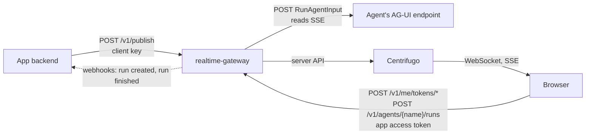

# realtime-gateway

One container that puts the backbone behind plain HTTP, so apps and agents use it without any SDK package:

- **Servers publish** with `POST /v1/publish` and their own key, limited to their tenants.
- **Servers get realtime tokens** for their users with `POST /v1/tokens/*`.
- **Browsers get realtime tokens** with the app's own access token, at `POST /v1/me/tokens/*`.
- **Agent runs go through the gateway.** The page posts a run to the gateway; the gateway calls the agent's existing AG-UI endpoint (RunAgentInput in, server-sent events out) and publishes the stream to a `replay` run channel. The agent needs no backbone code.
- **Pages load the client** from `GET /v1/client.js`, so they need no npm packages either.

The SDKs stay the better fit when a service already runs TypeScript, .NET or Python and publishes a lot: they talk to Centrifugo directly, with no extra hop.



## The extra hop

Publishing through the gateway is one more HTTP POST inside your network, a millisecond or two. Agent output does not wait on it in a way users notice: the gateway reads the agent's stream and publishes as it goes, in order, batching text deltas every 75 ms the same way the SDK sinks do. Subscribers never go through the gateway; they connect to Centrifugo.

## Endpoints

| Endpoint | Auth | Does |
| --- | --- | --- |
| `GET /healthz` | none | `ok` |
| `GET /.well-known/rtb-jwks.json` | none | Public key for the realtime tokens the gateway signs. Point Centrifugo's `client.token.jwks_public_endpoint` and `client.subscription_token.jwks_public_endpoint` here. |
| `GET /v1/config` | none | `{ backboneUrl, agents }` for the client |
| `GET /v1/client.js` | none | The browser client (ES module) |
| `POST /v1/publish` | `Authorization: Bearer <client key>` | Body `{ channel, type, data, corr? }`. The gateway builds the envelope (`id`, `ts`, `tenant`, `source` = the client's id), checks the channel and the client's tenants, and publishes in order per channel with retries. Returns `{ id, offset, epoch }`. |
| `POST /v1/tokens/connection` | client key with `"tokens": true` | Body `{ userId, info? }`, returns `{ token }` |
| `POST /v1/tokens/subscription` | client key with `"tokens": true` | Body `{ userId, channel }`, returns `{ token }`. Only for the client's tenants. |
| `POST /v1/me/tokens/connection` | `Authorization: Bearer <app access token>` | Returns `{ token }` for the signed-in user |
| `POST /v1/me/tokens/subscription` | app access token | Body `{ channel }`. Allowed for run channels the user started and channels matching `subscribe` rules. User channels need no token (the connection token covers them). |
| `POST /v1/agents/{name}/runs` | app access token | Body is RunAgentInput. A user with several tenants adds `?tenant=` to pick the run's tenant. Returns 202 `{ runId, threadId, channel, offset, epoch, token }`, the same shape the SDK run endpoints return, so `CentrifugoAgent` works unchanged. |
| `POST /v1/runs/{runId}/cancel` | app access token | Only the user who started the run. The run ends with `RUN_ERROR` code `rtb.cancelled`. |

Errors are JSON `{ error }`. Publish errors use the guard reasons from `spec/channels.md` (`invalid_channel`, `tenant_mismatch`, `global_not_allowed`).

## What a run does

1. Checks the user's access token against `users.jwksUrl` and reads their user ID and tenants. The run's tenant is the user's only tenant, or the `?tenant=` they named.
2. Calls the `runCreated` webhook, if set, with `{ runId, threadId, userId, tenant, agent, messages }`. Any non-2xx answer refuses the run with 403. This is where the app checks the thread belongs to the user and saves it.
3. Stores who owns the run (in Valkey when `valkey` is set, so every gateway copy knows), publishes `RUN_STARTED` and returns 202.
4. POSTs RunAgentInput (with the gateway's `runId`) to the agent, with the agent's `headers` and, when `forwardAuthorization` is on, the user's own access token, so the agent's tools can call the app as the user.
5. Publishes each event as `agui.<TYPE>`: drops the agent's own `RUN_STARTED`, turns `TEXT_MESSAGE_CHUNK` into start, content and end, batches text and tool-argument deltas, skips `skipTypes`, and replaces an event over 64 KB with `CUSTOM rtb.oversize`. A stream that ends without `RUN_FINISHED` or `RUN_ERROR` ends with `RUN_ERROR` code `rtb.agent_error`.
6. Calls the `runFinished` webhook, if set, with `{ runId, threadId, userId, tenant, agent, events, messages }`, where `messages` are the new assistant and tool messages, ready to append to the thread.

When `notifyUser` is on, it also publishes `notice.run_started` on the user's channel (`live:t-<tenant>.user#<userId>`, or `live:t-<inboxTenant>.user#<userId>` when `users.inboxTenant` is set) so their other tabs join the run.

## Config

`gateway.json`, from `-config` or `RTB_GATEWAY_CONFIG` (default `/etc/realtime-gateway/gateway.json`). Any `${NAME}` is replaced by the environment variable `NAME`, so secrets can stay out of the file.

```json
{
  "centrifugo": { "apiUrl": "http://backbone:9000/api", "apiKey": "${CENTRIFUGO_HTTP_API_KEY}" },
  "publicBackboneUrl": "https://rt.example.com",
  "valkey": "redis://valkey:6379",
  "signing": { "privateKeyFile": "/run/secrets/signing.jwk", "audience": "realtime-backbone", "issuer": "realtime-gateway" },
  "clients": [
    { "id": "orders-api", "key": "${ORDERS_API_KEY}", "tenants": ["*"], "tokens": true },
    { "id": "acme-worker", "key": "${ACME_WORKER_KEY}", "tenants": ["acme"] }
  ],
  "users": {
    "jwksUrl": "https://login.example.com/.well-known/jwks.json",
    "audience": "my-app",
    "issuer": "https://login.example.com/",
    "tenantClaim": "org_id",
    "nameClaim": "name"
  },
  "subscribe": ["live:t-{tenant}.tasks", "live:t-{tenant}.jobs.*"],
  "cors": ["https://app.example.com"],
  "agents": {
    "assistant": { "url": "http://agent:3000/agui", "forwardAuthorization": true, "notifyUser": true, "skipTypes": ["STATE_SNAPSHOT"] }
  },
  "webhooks": {
    "runCreated": "http://api:8080/internal/runs",
    "runFinished": "http://api:8080/internal/runs/{runId}/finished",
    "headers": { "X-Internal-Key": "${INTERNAL_KEY}" }
  }
}
```

| Key | Default | What |
| --- | --- | --- |
| `listen` | `:8090` | Address to listen on |
| `source` | `realtime-gateway` | Envelope `source` for run events |
| `centrifugo.apiUrl`, `centrifugo.apiKey` | required | Centrifugo's HTTP server API (the internal port) and its key |
| `publicBackboneUrl` | | Where browsers connect, returned by `/v1/config` |
| `valkey` | in memory | Keeps run owners and relays cancels, so several gateway copies can run. Leave empty for one copy only. |
| `signing.privateKey` or `signing.privateKeyFile` | required | EC P-256 private key, JWK or PEM. `kid` is the key's RFC 7638 thumbprint unless the JWK has one, the same as the SDKs. |
| `signing.audience`, `signing.issuer` | required | Must match Centrifugo's token audience and issuer |
| `signing.connectionTtl`, `signing.subscriptionTtl` | `10m` | Token lifetimes |
| `clients[]` | | Server callers: `id`, `key`, `tenants` (`"*"` for any), `allowGlobal` (may publish to `global` channels), `tokens` (may mint tokens) |
| `users.jwksUrl` | required with agents | The app's or identity provider's public keys |
| `users.audience`, `users.issuer` | not checked | Checked when set |
| `users.tenantClaim` | | Claim with the user's tenant, or a list of tenants for users who see several orgs; dots reach into objects, like `info.tenant`. Any other type is a 401. |
| `users.tenant` | | A fixed tenant, for single-tenant apps |
| `users.nameClaim` | | Claim copied into the connection token's `info.name`, for presence |
| `users.inboxTenant` | | A fixed tenant label for every user's channel, so a user with several tenants has one inbox. Run notices go there. |
| `subscribe[]` | | Channels a user may subscribe to. `{tenant}` is any of the user's tenants and `{userId}` is the user's; `*` is one segment. |
| `cors[]` | | Page origins allowed to call the gateway |
| `agents.<name>.url` | | The agent's AG-UI endpoint |
| `agents.<name>.headers` | | Extra headers for the agent, such as its own key |
| `agents.<name>.forwardAuthorization` | `false` | Send the user's access token to the agent |
| `agents.<name>.skipTypes` | | AG-UI event types not to publish, such as `STATE_SNAPSHOT`. Run, text message and tool call events can't be skipped. |
| `agents.<name>.notifyUser` | `false` | Publish `notice.run_started` on the user's channel |
| `agents.<name>.timeout` | `15m` | Longest a run may take |
| `agents.<name>.batchInterval` | `75ms` | How long text deltas are batched |
| `webhooks.runCreated`, `webhooks.runFinished`, `webhooks.headers` | | See "What a run does". `{runId}` in a URL is replaced. |
| `clientBundle` | `/usr/share/realtime-gateway/realtime-client.js` | The file served at `/v1/client.js` |

## Browser

```js
const { connectGateway } = await import('https://gateway.example.com/v1/client.js');
const gateway = await connectGateway({ url: 'https://gateway.example.com', accessToken: () => myAccessToken });

gateway.client.subscribe('live:t-acme.tasks', (e) => console.log(e.type, e.data));

const agent = gateway.agent('assistant', { threadId });   // an @ag-ui/client AbstractAgent; add tenant for users with several
agent.addMessage({ id: crypto.randomUUID(), role: 'user', content: 'Hello' });
await agent.runAgent();
```

The module also exports `createRealtimeClient`, `CentrifugoAgent`, `Channels`, `encodeId`, `decodeId`, `buildResumeArray`, `EventType` and `UnauthorizedError`. `samples/mastra-dotnet/web/src/gateway.ts` is a complete page.

## Server

```sh
curl -X POST https://gateway.example.com/v1/publish \
  -H "Authorization: Bearer $ORDERS_API_KEY" -H "Content-Type: application/json" \
  -d '{"channel":"live:t-acme.orders.42","type":"order.status","data":{"status":"shipped"}}'
```

## Run it

The dev stack runs it on port 8090 with `config/gateway.dev.json`, and `samples/mastra-dotnet` runs through it on port 3012 (`pnpm samples:up`). The image is `images/gateway/Dockerfile`.

## Tests

```sh
cd gateway && go test ./...
```

Without Go installed: `docker run --rm -v $PWD:/repo -w /repo/gateway golang:1.26-alpine go test ./...`. The tests include the shared contract vectors in `spec/vectors/` and full runs against a fake agent and a fake Centrifugo.
