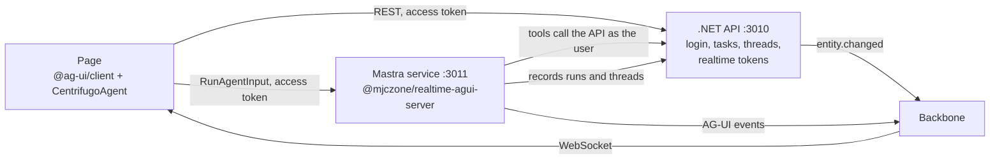
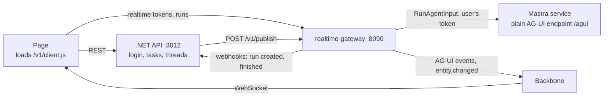

# mastra-dotnet

An app shaped like a common setup: a plain AG-UI page (`@ag-ui/client`, no CopilotKit), a .NET REST API that owns the app's data, and a Mastra service that runs the agent.



## Run

```sh
pnpm dev:up
pnpm samples:up
```

Open http://localhost:3010, sign in with any name, and try:

- **add a task: buy milk** · the agent's `createTask` tool calls `POST /api/tasks` on the .NET API with your access token. The API publishes `entity.changed`, and every open page refreshes its task list.
- **list my tasks** · a server tool reading from the API.
- **switch to dark mode** · a frontend tool. The page offers `setTheme` in `RunAgentInput.tools`; the agent asks for it, the run ends, the page runs it and sends the result in a new run, and the agent finishes.
- **delete all tasks** · a tool that needs approval (`requireApproval: true`). The run pauses with an AG-UI interrupt; the page shows Approve and Reject and resumes the run with `RunAgentInput.resume`. Reload while it waits and the prompt comes back.
- Add a task with the form in a second browser, or reload while the agent answers.

## How the pieces connect

| Concern | Where |
| --- | --- |
| Login | The .NET API issues an ES256 access token (dev only; a real app uses its identity provider). The agent service verifies it with the API's public keys (`/.well-known/app-jwks.json`) |
| Realtime tokens | The .NET API (`MapRealtimeTokenEndpoints` at `/api/realtime`). It knows who owns each run because the agent service records it |
| Runs | The agent service (`createRunEndpoints`). `onRunCreated` and `onRunFinished` call the API's `/internal/runs` endpoints with a service key |
| Threads | The .NET API stores them; the page loads a thread from `GET /api/threads/{id}` |
| Live data | The .NET API publishes `entity.changed` on `live:t-acme.tasks` with `MJCZone.Realtime.Publisher` over gRPC; the page refetches |
| Agent tools | Created per request with the caller's access token, so the API sees the real user |

Both services sign realtime tokens with the dev stack's key here. In production, put one signing key in the vault for both, and serve its JWKS from the .NET API.

## The same app through realtime-gateway (port 3012)

`pnpm samples:up` also starts a second copy wired through [`realtime-gateway`](../../gateway/README.md), at http://localhost:3012. It is the shape an existing AG-UI app keeps: nothing from this repo in the page, the API or the agent.



| | Port 3010 (SDKs) | Port 3012 (gateway) |
| --- | --- | --- |
| Page | Bundles `@mjczone/realtime-client` and `@mjczone/realtime-agui-client` (`web/src/app.ts`) | Imports the gateway's `/v1/client.js` (`web/src/gateway.ts`) |
| Realtime tokens | The .NET API | The gateway, from the user's access token and `subscribe` rules |
| Runs | `POST /api/run` on the agent (`@mjczone/realtime-agui-server`) | `POST /v1/agents/tasks/runs` on the gateway, which calls the agent's `POST /agui` |
| Runs and threads in the API | `onRunCreated`, `onRunFinished` | The gateway's `runCreated` and `runFinished` webhooks, same endpoints |
| `entity.changed` | `MJCZone.Realtime.Publisher` over gRPC | One HTTP POST to the gateway |

The API switches with `RTB_GATEWAY_URL` and `RTB_GATEWAY_KEY`; the gateway's config is `config/gateway.dev.json`. The same 8 browser tests run against both.

## Approval needs Mastra storage

Resuming after an approval loads the paused run from Mastra storage, so the agent is registered on a `Mastra` with a store that every run shares (`InMemoryStore` here). With more than one agent-service process, use a shared store such as LibSQL or Postgres. The page keeps the paused run stored, so a reload replays it and AG-UI restores `pendingInterrupts`, within the backbone's 10-minute history window.

## Tests

```sh
pnpm e2e tests/mastra-dotnet.spec.ts
```
